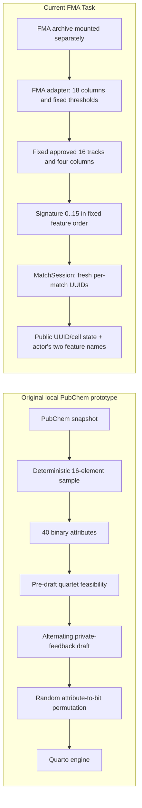
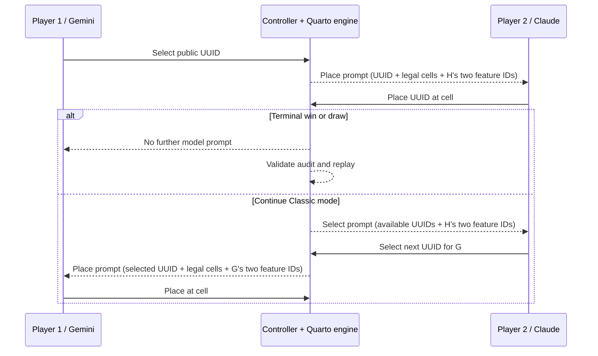

# Quarto — Current Game Design Reconstruction & Original Specification Audit

**Audit date:** 2026-11-14
**Scope:** Read-only reconstruction from the current worktree, available design notes, tests, and source data flow.

## 1. Executive summary

The repository contains three related but distinct implementations, not one end-to-end hidden-information game:

1. The original local PubChem prototype describes a pre-game attribute draft, private ownership of two accepted attributes per player, and a randomly permuted mapping into the existing Quarto engine. Its default seed-1729 data is infeasible, however, so the documented local experiment refuses to start the draft or game. The README explicitly calls this a data blocker, not a completed benchmark ([README.md](../README.md#L54-L72); [test_hidden_quarto_benchmark.py](../tests/test_hidden_quarto_benchmark.py#L133-L152)).
2. The current FMA two-model Task is a different, fixed-instance path. It loads the approved 16-track instance and four fixed feature columns, skips the attribute draft, assigns the first two feature IDs to Player 1 and the next two to Player 2, and forces Classic Quarto. Each model prompt contains its own two feature **names**, but no per-track feature values or signature mapping ([fma_pilot.py](../fma_pilot.py#L22-L54), [phase0_foundation.py](../phase0_foundation.py#L1030-L1050), [tournament_harness.py](../tournament_harness.py#L572-L611), [quarto_two_model_match.py](../kaggle_task/quarto_two_model_match.py#L716-L740)).
3. The local web and random-agent paths are not hidden-information agent interfaces: the web API returns each canonical piece's four traits, and `quarto_runner.py` passes the complete `GameState` to `RandomAgent` ([quarto_web.py](../quarto_web.py#L69-L80); [quarto_runner.py](../quarto_runner.py#L25-L43)).

The FMA Task preserves the Classic Quarto engine rules and the two-feature-per-player count. It does **not** preserve the original prototype's attribute-drafting process, randomized attribute-to-bit mapping, or player access to public per-entity attribute values. Most importantly, in the FMA model prompt a player receives feature labels without the corresponding values for any piece. The prompt therefore provides no direct evidence connecting the player's two features to the opaque public UUIDs. The game can still execute mechanically, but the current prompt contract does not implement the original data-grounded information game.

There is no standalone, versioned requirements document or decision record that resolves all original design questions. The original design below is reconstructed from the notebook narrative and its implementation; later reports are treated as later descriptions, not as proof of the original specification.

## 2. Original intended game design

The earliest located hidden-information design is the local “Quarto Hidden-Information Benchmark V1” notebook and `hidden_quarto_benchmark.py`. The notebook describes a frozen PubChem snapshot, deterministic selection of 16 elements, pre-draft feasibility, ownership-aware proposals, private attribute-to-bit mapping, and observation builders. It also explicitly warns that arbitrary Python in the same notebook kernel is not an isolation boundary ([notebooks/quarto_hidden_information_v1.ipynb](../notebooks/quarto_hidden_information_v1.ipynb#L8-L10), [notebooks/quarto_hidden_information_v1.ipynb](../notebooks/quarto_hidden_information_v1.ipynb#L114-L122), [notebooks/quarto_hidden_information_v1.ipynb](../notebooks/quarto_hidden_information_v1.ipynb#L190-L218), [notebooks/quarto_hidden_information_v1.ipynb](../notebooks/quarto_hidden_information_v1.ipynb#L214-L260)).

The source establishes these decisions:

- The PubChem version has 40 binary attribute definitions and chooses a deterministic 16-element sample from a public seed. Feasibility examines all 91,390 four-attribute combinations; the bounded seed search looks for at least two valid quartets ([hidden_quarto_benchmark.py](../hidden_quarto_benchmark.py#L34-L64), [hidden_quarto_benchmark.py](../hidden_quarto_benchmark.py#L454-L471), [hidden_quarto_benchmark.py](../hidden_quarto_benchmark.py#L533-L632)).
- The draft starts with Player 1. Players alternate proposing an attribute; each may own at most two accepted attributes. A proposal receives only generic `accepted`/`rejected` feedback in that proposer's private state. A completed draft must assign exactly two accepted attributes to each player ([hidden_quarto_benchmark.py](../hidden_quarto_benchmark.py#L634-L832)).
- A feasible accepted quartet is mapped to the four engine bits using a system-random permutation, after the draft. The mapping remains in the trusted controller ([hidden_quarto_benchmark.py](../hidden_quarto_benchmark.py#L834-L874)).
- Draft public observations include the selected element data and all attribute definitions; `ElementRecord.to_public_dict()` includes each element's complete attribute-value map. The private observation adds only that recipient's accepted attributes and feedback ([hidden_quarto_benchmark.py](../hidden_quarto_benchmark.py#L97-L134), [hidden_quarto_benchmark.py](../hidden_quarto_benchmark.py#L888-L940)).
- The original Quarto controller maps public element symbols to internal pieces and sanitizes the terminal result. Its public game observations still include element symbols and the complete element data; its private payload is recipient-filtered ([hidden_quarto_benchmark.py](../hidden_quarto_benchmark.py#L954-L1118)).

The documented default run is not an actual playable benchmark: the deterministic seed-1729 sample has zero valid quartets. The notebook and tests report that the draft and game are skipped rather than silently changing the seed or data ([README.md](../README.md#L62-L72), [test_hidden_quarto_benchmark.py](../tests/test_hidden_quarto_benchmark.py#L61-L89), [test_hidden_quarto_benchmark.py](../tests/test_hidden_quarto_benchmark.py#L133-L152)).

## 3. Actual current game architecture

The FMA Task path is:

1. Resolve the configured Task model and the registry model.
2. Verify/load the staged source snapshot, require the external FMA archive and explicit license acknowledgment, and load the fixed FMA pilot.
3. Run security preflight with the actual FMA adapter, fixed instance, and Task public-replay projector.
4. Bind the two model handles to fixed player seats and run one `classic` match starting with Player 1.
5. Accept Task success only after completed match, audit and replay validation, valid terminal result, and valid public replay ([quarto_two_model_match.py](../kaggle_task/quarto_two_model_match.py#L652-L740), [quarto_two_model_match.py](../kaggle_task/quarto_two_model_match.py#L745-L775)).

The Task does not use a synthetic adapter or fake agent fallback. It passes the loaded FMA adapter and instance into both security preflight and `TournamentRunner.run_match`; the Task explicitly rejects missing real-instance sources rather than using a smoke fixture ([quarto_two_model_match.py](../kaggle_task/quarto_two_model_match.py#L673-L705)). Synthetic agents appear in local tests and in the generic security-audit helper's no-adapter default, not in this Task call path ([tournament_harness.py](../tournament_harness.py#L1342-L1357), [test_quarto_two_model_task.py](../tests/test_quarto_two_model_task.py#L330-L352)).

This is a source-level reconstruction only. No Kaggle Task, hosted Notebook, or live model was executed for this audit; model-registry availability and hosted access controls are not independently verified.

## 4. Feature selection and instance construction

### General FMA adapter

The FMA adapter defines an 18-column gameplay feature pool. Each feature is one named descriptor family, statistic, and coordinate from `features.csv` (for example, chroma, MFCC, RMSE, spectral, Tonnetz, or zero-crossing-rate statistics). It reads the track metadata fields `album`, `artist`, `title`, `genre_top`, and `genres`, and retains them in `adapter.track_metadata`; those fields are not used as gameplay features ([fma_adapter.py](../domain_adapters/fma_adapter.py#L44-L62), [fma_adapter.py](../domain_adapters/fma_adapter.py#L150-L221), [fma_adapter.py](../domain_adapters/fma_adapter.py#L434-L439)).

The general adapter sorts numeric track IDs, samples a seeded subset (the pilot configuration is 25,000 tracks with seed 11), reads the selected feature columns, and binarizes each numeric value as `value > feature.threshold`; equality is false. Its general `build_instance()` delegates to strict generation over the complete gameplay-feature pool. When called to generate a general instance, the builder can examine candidate quartets in seed-controlled order; this is not what the approved Task does per match ([fma_adapter.py](../domain_adapters/fma_adapter.py#L69-L139), [fma_adapter.py](../domain_adapters/fma_adapter.py#L223-L279), [fma_adapter.py](../domain_adapters/fma_adapter.py#L281-L439), [dataset_adapter.py](../domain_adapters/dataset_adapter.py#L256-L290), [instance_builder.py](../domain_adapters/instance_builder.py#L535-L630)).

### Approved fixed FMA pilot

The Task loader does not resample a new candidate or choose a replacement quartet. It validates `fma_seed11_candidate_ordinal_0003_v1`, fixes four feature IDs and their thresholds, subsets the loaded domain to the exact 16 source entities, rebuilds their signatures, and revalidates the candidate. The selected columns are:

| Bit order | Feature ID | Threshold |
|---:|---|---:|
| 0 | `fma:chroma_cens:mean:01` | `0.25517144799232483` |
| 1 | `fma:chroma_cqt:median:11` | `0.4525887370109558` |
| 2 | `fma:chroma_stft:skew:05` | `0.3928850293159485` |
| 3 | `fma:spectral_bandwidth:min:01` | `290.3798522949219` |

These values and all 16 source IDs are also present in the staged pilot artifact. Its `entity_ids_signature_order` and `signature_values_signature_order` arrays establish a static source-ID-to-signature mapping; the loader independently checks those lists and requires the strict validation record with `accepted: true`, `id_level_count: 2`, and `structural_count: 2` ([fma_pilot.py](../fma_pilot.py#L22-L54), [fma_pilot.py](../fma_pilot.py#L92-L150), [fma_pilot.py](../fma_pilot.py#L155-L235), [fma_pilot_instance.json](../fma_pilot_instance.json#L1-L63), [staging manifest](../kaggle_dataset_staging/quarto-two-model-source-v1/manifest.json#L64-L80)).

For this validator, `id_level_count` counts eligible four-feature combinations that give the 16 selected entities exactly one instance of each 4-bit signature. `structural_count` counts the distinct canonical structural classes among those valid combinations. They are instance acceptance counts, not a count of pieces, wins, or player knowledge ([instance_builder.py](../domain_adapters/instance_builder.py#L109-L264)).

The selected four feature values, in the `InstanceSpec.feature_ids` order, form the four-bit signature `0..15`. The engine uses that integer directly as its internal piece ID. Thus feature ordering is significant and checked against the data; the fixed pilot has one entity for each bit pattern. That does not mean either model receives the bit pattern ([instance_builder.py](../domain_adapters/instance_builder.py#L180-L210), [phase0_foundation.py](../phase0_foundation.py#L978-L1048), [quarto_engine.py](../quarto_engine.py#L106-L110)).

The FMA archive is excluded from the staged source package and is mounted separately at runtime. The adapter has the archive, sampled values, and retained metadata; none of those objects are passed as an agent prompt field ([quarto_two_model_match.py](../kaggle_task/quarto_two_model_match.py#L36-L49), [quarto_two_model_match.py](../kaggle_task/quarto_two_model_match.py#L681-L698), [fma_adapter.py](../domain_adapters/fma_adapter.py#L281-L439)).

## 5. Player 1 information and visibility

For the fixed pilot, Player 1 is `google/gemini-3.8-flash` and receives the first two entries of the fixed feature order:

- `fma:chroma_cens:mean:01`
- `fma:chroma_cqt:median:11`

This is a private payload of two **feature IDs**, not per-track values. The public prompt contains only the approved public projection: mode, phase, current player, board UUIDs, available UUIDs, selected UUID, legal actions, public history, and terminal flag. It excludes the controller's public-entity roster and requester marker ([phase0_foundation.py](../phase0_foundation.py#L63-L90), [phase0_foundation.py](../phase0_foundation.py#L323-L371), [tournament_harness.py](../tournament_harness.py#L572-L611)).

## 6. Player 2 information and visibility

Player 2 is `anthropic/claude-sonnet-4-6@default` and receives the last two entries:

- `fma:chroma_stft:skew:05`
- `fma:spectral_bandwidth:min:01`

The assignments are different and fixed by feature order: `MatchSession` assigns indices `[:2]` to Player 1 and `[2:4]` to Player 2. `Phase0Controller.private_observation()` and `MatchSession.private_observation()` reject a requester that is not the active player; the projection checks that the private requester matches `current_player` and that the embedded public state is identical to the validated public observation ([phase0_foundation.py](../phase0_foundation.py#L1030-L1050), [phase0_foundation.py](../phase0_foundation.py#L330-L371), [phase0_foundation.py](../phase0_foundation.py#L1189-L1201), [phase0_foundation.py](../phase0_foundation.py#L1410-L1423)).

There is no current FMA draft, so `proposal_feedback` is initialized to `None` and no Phase 0 match action updates it. The private field remains part of the schema, but is not feedback from an attribute proposal ([phase0_foundation.py](../phase0_foundation.py#L1043-L1051), [phase0_foundation.py](../phase0_foundation.py#L1189-L1201)).

### Player/evaluator visibility table

The table describes the **FMA Task model prompt and Task artifacts**, not the separate local UI or PubChem prototype.

| Information category | Player 1 | Player 2 | Evaluator |
|---|---|---|---|
| Board cells, public UUIDs, available choices, public history, legal action | Visible | Visible | Visible from public replay/log |
| Own two FMA feature IDs | Visible on Player 1 turns | Visible on Player 2 turns | Both ownership sets are in restricted audit data; not in Task result |
| Opponent's two FMA feature IDs | Hidden from prompt | Hidden from prompt | Both are in restricted audit data; static feature order is in the source package |
| Per-track values for the four selected features | Not present | Not present | Recoverable as four-bit signatures from restricted mappings; raw feature values/metadata are not embedded in that audit |
| Internal piece IDs and feature-to-bit mapping | Not present | Not present | Present in restricted audit data |
| Per-match public-UUID-to-source-ID crosswalk | Not present | Not present | Present in restricted audit data |
| Static FMA source IDs and source-ID-to-signature assignment | Not sent in prompt; visible to a reader of the staged source package | Not sent in prompt; visible to a reader of the staged source package | Present in the staged artifact; exact match UUID crosswalk additionally requires restricted audit data |
| Artist, album, title, and genre metadata | Not present | Not present | Not in the match audit or Task result; available only to host code holding the adapter/archive |
| Full prompt and response history | Each sees only the prompt sent to it; no host-resource tools are offered | Each sees only the prompt sent to it; no host-resource tools are offered | Available in local restricted Harness logs; not emitted in the Task result |
| Authoritative terminal outcome | No later terminal prompt is issued | No later terminal prompt is issued | In restricted audit; public Task replay also includes sanitized result |

The Task prompt construction is an actual allowlisted serialization path: `AgentAdapter.build_messages()` invokes `project_agent_observations()`, then serializes the public projection plus only the requester-private payload. The Kaggle adapter merges those two messages into a single string for `llm.prompt()`; it does not pass the controller object or dataset adapter ([tournament_harness.py](../tournament_harness.py#L66-L79), [tournament_harness.py](../tournament_harness.py#L572-L611), [kaggle_agent_adapter.py](../kaggle_agent_adapter.py#L20-L54)). The Task creates separate chat contexts per player, but hosted context behavior was not executed or independently verified ([quarto_two_model_match.py](../kaggle_task/quarto_two_model_match.py#L559-L577)).

The system message says the agent has no tools or access to host resources ([tournament_harness.py](../tournament_harness.py#L66-L79)). That is the declared model-call contract, not proof about every hosted platform boundary. The staged package itself includes the artifact with static source IDs and their signatures. The per-match UUID crosswalk is separate: the artifact alone does not say which random UUID in a particular prompt belongs to which source ID.

The original PubChem prototype had a different visibility rule. Its public observations include all selected entities, all 40 binary attribute values per entity, and all attribute definitions, while private observations show only the recipient's two accepted attributes and feedback. The FMA Task omits those per-entity values entirely ([hidden_quarto_benchmark.py](../hidden_quarto_benchmark.py#L117-L134), [hidden_quarto_benchmark.py](../hidden_quarto_benchmark.py#L888-L940), [hidden_quarto_benchmark.py](../hidden_quarto_benchmark.py#L1040-L1095)).

## 7. Evaluator information and authority

The authoritative game truth is produced by `quarto_engine` and mediated by `Phase0Controller`: legal actions are generated from engine state; selection and placement are checked against the active player and phase; the controller translates public UUIDs to internal piece IDs; and audit/replay validation compares the serialized engine history and public artifacts ([quarto_engine.py](../quarto_engine.py#L135-L151), [phase0_foundation.py](../phase0_foundation.py#L1203-L1254), [phase0_foundation.py](../phase0_foundation.py#L619-L738)).

The `AuditSnapshot` deliberately separates:

- **Public audit:** match/mode/starting player/phase/current player, selected UUID, UUID board, public history, sanitized result, and public legal actions.
- **Restricted evaluator data:** UUID-to-piece and piece-to-UUID maps, feature-to-bit mapping, both ownership sets, engine replay/state snapshot, and—when supplied—the per-match public-UUID-to-source-ID crosswalk ([phase0_foundation.py](../phase0_foundation.py#L1255-L1332)).

Using `entity_to_piece`, `feature_to_bit`, and `public_entity_to_source_id` together, a recipient of the restricted audit can recover each public UUID's source track and four-bit signature. This is not available in public observations or the public replay. FMA artist/album/title/genre metadata is retained on the adapter, not copied into the audit snapshot.

There is a separate `evaluator` package. Its documented v0.1 scope consumes restricted Harness logs, Decision Traces, and human gold annotations; it does not run a model or infer the truth of claims from game rules. The actual FMA Task does not invoke that evaluator: it returns `evaluator.status == "not_run"` because there are no match-specific human annotations. It also declares private trace storage `not_emitted`; it returns only an allowlisted public replay rather than the restricted Harness log ([evaluator documentation](../docs/evaluator_v0_1.md#L1-L42), [evaluator API](../evaluator/report.py#L570-L601), [Task result construction](../kaggle_task/quarto_two_model_match.py#L777-L832)).

The active-player check is enforced by code, but the requester value is a trusted host-supplied string, not cryptographic authentication. The controller's own documentation states this limitation ([phase0_foundation.py](../phase0_foundation.py#L1351-L1360)). Similarly, withholding a mapping from a model prompt is not a storage access-control mechanism for anyone who can inspect the staged package or the in-process controller.

## 8. Piece identity and signature lifecycle

| Concept | Meaning and lifecycle |
|---|---|
| Original FMA source track ID | Numeric ID read from FMA `tracks.csv`/`features.csv`; also used as the adapter's entity ID and the fixed pilot's `InstanceSpec.entity_id`. |
| Internal entity ID | In the FMA path, the same string as the source track ID before public projection. |
| Four-bit signature | Four binary values in the fixed feature order; exactly one pilot entity has each value `0..15`. |
| Internal engine piece ID | The integer signature itself; the engine interprets its bits through its four canonical attribute pairs. |
| Public piece/entity ID | A fresh UUIDv4 hex string generated for each `MatchSession` and kept stable for the duration of that match. |
| Board cell | Public integer `0..15` denoting a location, not a signature or piece identity. |
| Per-match UUID crosswalk | Internal source-ID-to-UUID map; its inverse is included only in restricted evaluator data when supplied. |

The UUID generation and signature translation occur in `MatchSession`; public entity ordering is by sorted UUID, not by source ID or signature. Public actions, board state, public history, and Task replay use the UUIDs and cell indices. The private audit retains the crosswalk and internal mappings ([phase0_foundation.py](../phase0_foundation.py#L1030-L1050), [phase0_foundation.py](../phase0_foundation.py#L1117-L1149), [phase0_foundation.py](../phase0_foundation.py#L1153-L1187), [phase0_foundation.py](../phase0_foundation.py#L1255-L1332), [quarto_two_model_match.py](../kaggle_task/quarto_two_model_match.py#L87-L205)).

Two confidentiality statements must not be conflated:

- The **per-match** public-UUID-to-source-ID crosswalk is restricted in the audit and omitted from player prompts and Task public replay.
- The **static pilot artifact** lists the approved source IDs in signature order and the matching signature values. It is included in the staged package. A package reader can therefore recover static source-ID-to-signature membership even though that reader cannot associate a given match's random public UUID with a source ID without the per-match crosswalk ([fma_pilot_instance.json](../fma_pilot_instance.json#L29-L63), [staging manifest](../kaggle_dataset_staging/quarto-two-model-source-v1/manifest.json#L64-L80)).

The FMA metadata archive itself is not in the staging package; the Task requires it as a separate mounted input. The adapter retains descriptive metadata for its sampled tracks, but the Task's prompt and public result constructors do not serialize it ([quarto_two_model_match.py](../kaggle_task/quarto_two_model_match.py#L36-L49), [fma_adapter.py](../domain_adapters/fma_adapter.py#L150-L221), [fma_adapter.py](../domain_adapters/fma_adapter.py#L434-L439)).

## 9. Complete gameplay walkthrough

The Task always invokes `TournamentRunner.run_match()`, which constructs a `Phase0Controller` in `classic` mode. It starts with Player 1. The engine also supports `self_selection`, but that mode is not used by the two-model Task ([tournament_harness.py](../tournament_harness.py#L886-L910), [quarto_engine.py](../quarto_engine.py#L9-L18), [quarto_two_model_match.py](../kaggle_task/quarto_two_model_match.py#L735-L740)).

1. **Initialization:** `new_game()` creates an empty 4×4 board, 16 remaining pieces, no selected piece, and the specified starting player ([quarto_engine.py](../quarto_engine.py#L83-L99)).
2. **Initial selection:** Player 1 receives the current public state and their private two-feature-ID payload. Legal select actions list public UUIDs, not internal piece IDs or signatures.
3. **Handoff:** In Classic mode, the selecting player chooses a piece for the other player to place. Thus Player 1 selects first and Player 2 places first ([quarto_engine.py](../quarto_engine.py#L164-L191)).
4. **Placement:** The placer chooses a legal empty cell. The selected piece remains in `remaining_pieces` through the place phase and is removed when placed; the UUID appears in that board cell. Public history records the selection actor/UUID and placement actor/cell ([quarto_engine.py](../quarto_engine.py#L193-L216), [phase0_foundation.py](../phase0_foundation.py#L1203-L1254)).
5. **Next selection:** After a nonterminal placement in Classic mode, the placer becomes the next selector. The same player therefore places the offered piece and then chooses the following piece for the opponent. The other player gets the next placement turn ([quarto_engine.py](../quarto_engine.py#L258-L271)).
6. **Win:** The engine checks the ten rows, columns, and diagonals. A win occurs when all four pieces on a line share at least one of the four binary attributes (one value from an attribute pair). The placer wins immediately; win is tested before draw ([quarto_engine.py](../quarto_engine.py#L18-L28), [quarto_engine.py](../quarto_engine.py#L106-L132), [quarto_engine.py](../quarto_engine.py#L219-L237)).
7. **Draw and termination:** If no winning line exists and the final piece has been placed, the result is a board-full draw with no winner. Terminal state has no selected piece; replay validation checks the terminal result against the engine state ([quarto_engine.py](../quarto_engine.py#L238-L272), [quarto_engine.py](../quarto_engine.py#L400-L459)).
8. **Match result:** The runner does not mark a match completed unless it reaches terminal state and its audit/replay validation and authoritative result checks pass. The Task additionally validates its public replay projection before returning success ([tournament_harness.py](../tournament_harness.py#L1018-L1087), [quarto_two_model_match.py](../kaggle_task/quarto_two_model_match.py#L745-L775)).

The Task executes one match with Player 1 as the starting player. `TournamentRunner.run_two_match_pilot()` exists and keeps model assignments fixed while swapping the starting player, but the Task does not call it. Thus the Task's single result does not counterbalance the player seats: Gemini selects first and Claude places first. Local fake-agent tests exercise the two-starting-player helper, which is not evidence that the Task does so ([tournament_harness.py](../tournament_harness.py#L1090-L1113), [test_fma_pilot.py](../tests/test_fma_pilot.py#L95-L180)).

The model messages do not include the four-bit signature, the Quarto engine's internal piece ID, or any of the four per-entity FMA feature values. The feature IDs identify columns conceptually but do not identify which public UUID has which value.

## 10. Original design versus current implementation

Statuses are relative to the recovered original PubChem notebook/prototype. `NOT_DOCUMENTED` means no original requirement was located; `UNVERIFIABLE` means code/configuration exists but actual hosted behavior was not observed.

| Design requirement | Original documented intention | Current implementation | Evidence | Status |
|---|---|---|---|---|
| Domain and feature pool | Frozen PubChem data with 40 binary attribute definitions | FMA adapter has 18 audio-derived feature columns; current pilot selects four | [original pool](../hidden_quarto_benchmark.py#L34-L64); [FMA pool](../domain_adapters/fma_adapter.py#L44-L62) | `DIVERGED` |
| Select 16 entities and require complete four-bit coverage | Seeded 16-entity sample; pre-draft checks quartet feasibility | Fixed FMA pilot has 16 entities, exactly one per signature `0..15`, revalidated before the match | [original selection](../hidden_quarto_benchmark.py#L454-L471); [pilot loader](../fma_pilot.py#L155-L235); [validator](../domain_adapters/instance_builder.py#L109-L264) | `MATCH` |
| Feature selection | Players draft four attributes from a feasible pool | Pilot has a fixed quartet; generic builder can search the 18-feature pool, but the Task does not call it to choose a new quartet | [original draft](../hidden_quarto_benchmark.py#L661-L832); [fixed loader](../fma_pilot.py#L155-L235) | `DIVERGED` |
| Exactly two features per player | Draft ownership ends with two accepted attributes per player | First two fixed feature IDs go to Player 1; last two to Player 2 | [original ownership](../hidden_quarto_benchmark.py#L700-L832); [current split](../phase0_foundation.py#L1038-L1048) | `PARTIAL` |
| Per-entity feature evidence | Public PubChem observation has each entity's 40 attribute values and definitions | FMA prompt has UUIDs and owned feature names, but no per-track feature values | [original public data](../hidden_quarto_benchmark.py#L888-L915); [current prompt allowlist](../phase0_foundation.py#L63-L90), [FMA projection](../phase0_foundation.py#L330-L371) | `DIVERGED` |
| Proposal feedback | Generic accept/reject feedback is private to the proposing player | No FMA proposal phase; Phase 0 `proposal_feedback` remains `None` | [original feedback](../hidden_quarto_benchmark.py#L700-L832); [current initialization/use](../phase0_foundation.py#L1043-L1051), [current private payload](../phase0_foundation.py#L1189-L1201) | `DIVERGED` |
| Attribute-to-piece mapping | Random permutation created after feasible draft and retained in trusted controller | Fixed feature order maps values to bits; random per-match UUIDs hide the public identity mapping, not the fixed source-ID-to-signature assignment | [original mapping](../hidden_quarto_benchmark.py#L834-L874); [current signature mapping](../fma_pilot.py#L183-L209), [UUID mapping](../phase0_foundation.py#L1117-L1149) | `PARTIAL` |
| Source identity confidentiality | Original prototype publicly returns element symbols and element data; no source secrecy requirement is stated | Runtime prompt uses opaque UUIDs, but staged pilot artifact exposes static source IDs and signatures | [original public entities](../hidden_quarto_benchmark.py#L888-L915); [current mapping](../phase0_foundation.py#L1117-L1187); [artifact](../fma_pilot_instance.json#L29-L63) | `PARTIAL` |
| Classic Quarto rules | Reuse existing engine; Classic is the default prototype mode | Task forces `classic`; engine preserves selection/handoff, four-in-line win, and full-board draw rules | [original controller](../hidden_quarto_benchmark.py#L954-L1018); [current engine](../quarto_engine.py#L164-L272) | `MATCH` |
| Self-selection variant | Engine mode is available, but not the original benchmark's stated focus | Engine supports it; tournament runner and Kaggle Task use Classic only | [engine modes](../quarto_engine.py#L9-L18); [runner](../tournament_harness.py#L886-L910) | `PARTIAL` |
| Evaluator authority and access | Trusted controller owns the secret mapping; notebook evaluator/storage boundary is not specified as a separate product | Engine/controller is authoritative; separate evaluator needs restricted Harness logs and human labels; Task evaluator is not run and private logs are not emitted | [original trust note](../notebooks/quarto_hidden_information_v1.ipynb#L8-L10); [evaluator scope](../docs/evaluator_v0_1.md#L1-L42); [Task output](../kaggle_task/quarto_two_model_match.py#L817-L832) | `PARTIAL` |
| Kaggle deployment and fixed model pair | Original notebook explicitly describes a local experiment without Kaggle integration | A Kaggle Task is configured for Gemini as Player 1 and Claude as Player 2; hosted availability and behavior were not verified | [README](../README.md#L54-L72); [model mapping](../kaggle_task/quarto_two_model_match.py#L20-L22), [Task resolution](../kaggle_task/quarto_two_model_match.py#L579-L630) | `DIVERGED` |
| Actual hosted execution | Original notebook was local and default data infeasible | Task source contains a hosted path, but no hosted Task/model run occurred in this audit | [README](../README.md#L62-L72); [Task entry point](../kaggle_task/quarto_two_model_match.py#L652-L835) | `UNVERIFIABLE` |

## 11. Confirmed deviations and unresolved questions

### Confirmed deviations

- The FMA pilot is not the original PubChem attribute-drafting experiment. It is a fixed candidate loaded and validated without interactive feature selection.
- The original prototype exposes public per-entity attribute values. The FMA prompt omits per-entity values altogether. Its private feature names therefore do not let an agent identify which public UUID has a given feature value.
- The original draft's random attribute-to-bit permutation is not the FMA pilot mechanism. FMA feature order fixes the bit assignment; only the mapping from source ID to per-match public UUID is newly randomized.
- The public runtime prompt hides FMA source IDs and metadata, but the source package includes the approved source IDs and static source-ID-to-signature assignment. Prompt privacy is not package confidentiality.
- The current Task runs one fixed-seat match. A two-starting-player helper exists but is not used by the Task.
- The Task result does not include restricted audit logs or decision traces, and its evaluator reports `not_run`.
- The original PubChem notebook's default public seed does not yield a playable game, so the original end-to-end experiment has not been demonstrated by the checked-in default run.

### Questions evidence cannot settle

1. Is the PubChem draft-and-play design still the intended game, or is the FMA fixed-instance Task an intentionally different experiment?
2. Should private feature ownership mean only knowing two feature names, or knowing those features' values for each offered/placed entity? The current prompt implements only the former.
3. Is the static FMA membership and source-ID-to-signature mapping intended to be visible to anyone who can inspect the source package? The per-match UUID crosswalk is a separate restricted value.
4. Is a single Gemini/Claude match with Player 1 always starting the intended comparison condition?
5. What access-controlled destination, if any, is intended for restricted prompts, traces, and crosswalks so a separate evaluator can use them?
6. FMA rights remain conditional in the repository's attribution and license records; this game-design audit does not resolve them ([README.md](../README.md#L87-L105)).
7. Actual Kaggle model registry availability, Notebook conversion parity, provider behavior, and hosted storage/access controls remain unverified because no hosted execution occurred.

## 12. Critical risks to scientific validity

1. **No feature-value signal in model prompts.** Each model receives two names but no values attached to the candidate UUIDs. The current benchmark therefore does not test reasoning over its selected FMA features as presented to the model.
2. **Fixed, coverage-selected pilot.** The 16 tracks are fixed to yield all 16 signatures exactly once, and the accepted candidate is additionally constrained by the validator's count criteria. This is a deliberately structured instance, not a representative sample of FMA tracks or natural feature frequencies.
3. **Static membership disclosure.** The staged package exposes source-ID/signature membership. The model prompt does not expose it, but the project has no basis to claim package-level confidentiality.
4. **No matched seat comparison in the Task.** The Task starts Player 1 every time; one match cannot separate model effects from seat/starting-role effects.
5. **No evaluator output.** The Task emits a public replay but not private traces or the restricted audit. The configured human-adjudicated evaluator is not run, so no claims about explanations, evidence use, or information-seeking can be measured by this Task result.
6. **Original baseline is not executable at the default seed.** The PubChem prototype's default sample has zero feasible quartets; its original end-to-end game behavior is therefore not demonstrated by the default notebook.
7. **Hosted/runtime and rights limits.** Model registry behavior and hosted Notebook equivalence were not verified. The FMA rights position remains conditional; neither code inspection nor a local test establishes commercial clearance.
8. **Isolation is interface-level.** Exact schemas and requester checks limit data passed through the model prompt, but neither a same-process Python object nor the staged source package is an access-control boundary. The hosted provider/platform boundary remains unverified.

These are validity limitations, not findings that the Quarto engine's local state transitions are incorrect.

## 13. Overall conclusion

**The implementation has preserved the core Classic Quarto mechanics, but it has not preserved the original hidden-information game design end to end.** The current FMA pilot is a materially different fixed-instance experiment: it removes the draft, fixes the feature quartet and membership, replaces randomized feature-to-bit mapping with a fixed mapping, and gives each model two feature labels without the per-entity values needed to connect those labels to the pieces. Its opaque per-match UUIDs do hide the runtime source crosswalk in the model prompt, while the staged artifact still discloses static source-ID/signature membership.

Accordingly, the FMA pilot is best described as a fixed Quarto plumbing/competition path over a selected FMA-derived instance, not as a faithful, playable realization of the original PubChem draft-and-play benchmark. Whether that difference is intentional requires the project owner's design decision; this report makes no implementation proposal.

**Audit boundary:** This task changed only this report. No source, tests, configuration, dataset, or staging payload was modified. No local test suite, Kaggle Task, hosted Notebook, live model, or external API was run; no Git mutation was made.
